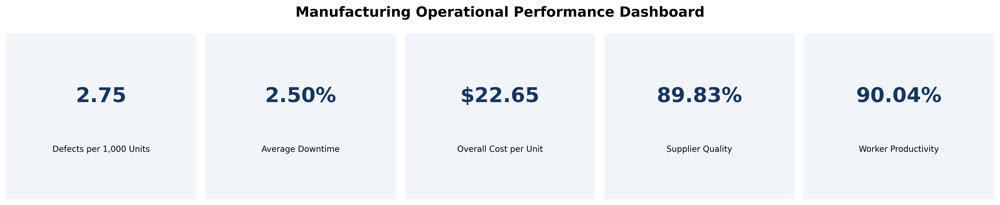

# Manufacturing Quality & Operational KPI Analysis

**Python | Pandas | Matplotlib | Manufacturing Analytics | KPI Reporting**

## Project Overview

This project explores how manufacturing production data can be transformed into operational KPIs and actionable business recommendations.

Using a synthetic dataset of 3,240 manufacturing observations, I developed a Python-based analytical workflow to evaluate production quality, operational performance, and cost efficiency.

The project focuses on three business questions:

1. How can manufacturing performance be measured through clearly defined KPIs?
2. Are higher defect rates associated with supplier quality, downtime, maintenance, or workforce productivity?
3. What do production volume and cost data reveal about operational efficiency?

## Tools and Methods

- **Python:** Pandas and Matplotlib
- **Data validation:** Missing values, duplicates, and variable inspection
- **KPI calculation:** Quality, downtime, cost efficiency, supplier performance, and productivity
- **Exploratory analysis:** Distributions, Pearson correlations, and operational group comparisons
- **Reporting:** KPI dashboard, visualisations, and business recommendations

## Key Performance Indicators

| KPI | Calculation | Result |
|---|---|---|
| Average defect rate | Mean recorded defect rate | 2.75 defects per 1,000 units |
| Average downtime | Mean downtime percentage | 2.50% |
| Overall production cost per unit | Total production cost / Total production volume | $22.65 per unit |
| Average supplier quality | Mean supplier quality | 89.83% |
| Average worker productivity | Mean worker productivity | 90.04% |

### Manufacturing KPI Dashboard

The dashboard provides a visual summary of five key
manufacturing performance indicators, supporting
operational monitoring and quality assessment.

## Key Findings

**Quality monitoring:** 740 of 3,240 observations (22.84%) exceeded an illustrative threshold of 4 defects per 1,000 units. This identifies records for potential investigation, not the percentage of defective products.

**Potential quality drivers:** Eight examined operational variables showed negligible linear correlations with defect rate (all absolute Pearson correlations below 0.04). Group comparisons did not reveal substantial differences in the selected operational metrics.

**Cost efficiency:** Production volume was negatively correlated with calculated cost per unit (r = -0.7261). Because volume is also the denominator in the unit-cost calculation, this relationship should not be interpreted as evidence of economies of scale.

## Business Recommendations

- Establish validated quality thresholds to support consistent monitoring and investigation.
- Collect batch-level, equipment-level, and process-parameter data to enable more targeted root-cause analysis.
- Validate production cost allocation before using unit-cost patterns to guide operational decisions.

## Project Files

- `Manufacturing_Quality_Analysis.ipynb` — Complete analysis, visualisations, KPI definitions, and recommendations
- `manufacturing_defect_dataset.csv` — Synthetic dataset used in the analysis

## Dataset and Attribution

Dataset: [Predicting Manufacturing Defects Dataset](https://www.kaggle.com/datasets/rabieelkharoua/predicting-manufacturing-defects-dataset)

Creator: Rabie El Kharoua

License: Creative Commons Attribution 4.0 (CC BY 4.0)

The dataset is synthetic and is used for educational and portfolio purposes. The original dataset creator is credited above.

## Limitations

This is an independent portfolio project, not an analysis of actual FUJIFILM manufacturing operations. The dataset does not include dates, so time-series analysis is not possible. Findings are exploratory, and the proposed recommendations have not been implemented or validated in a production environment.
